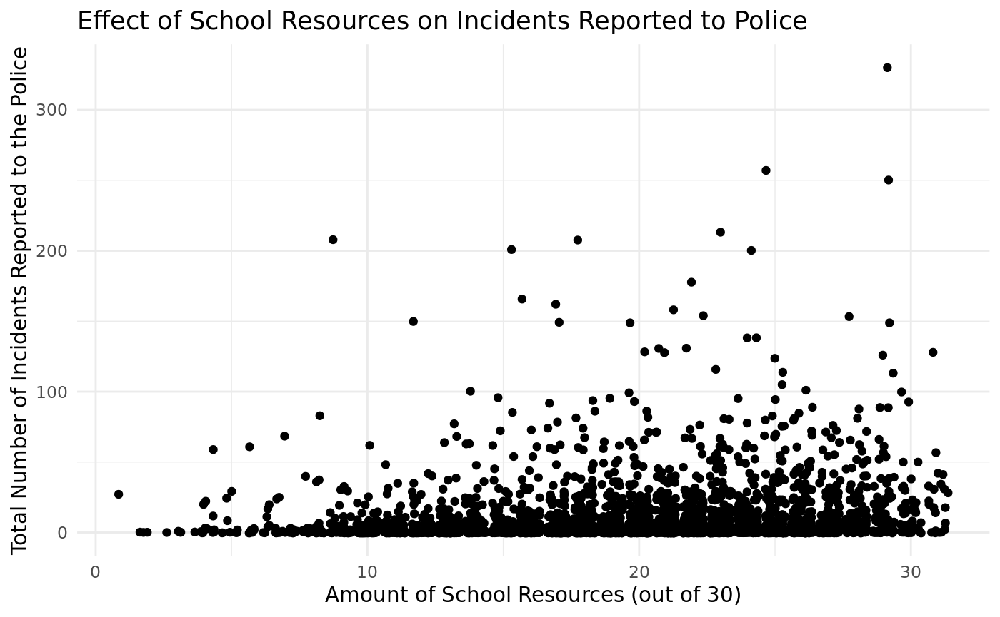
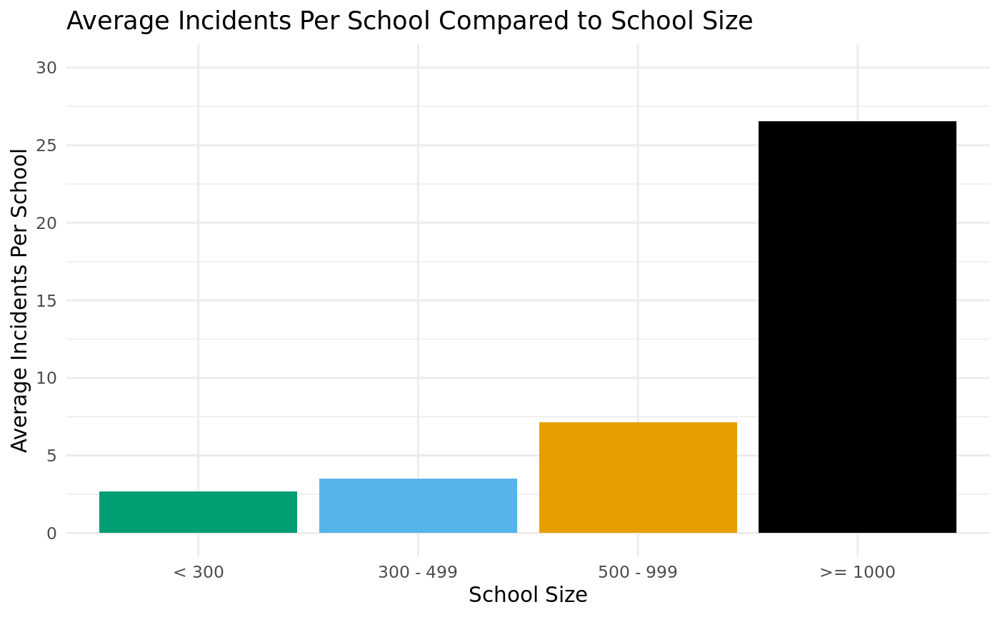
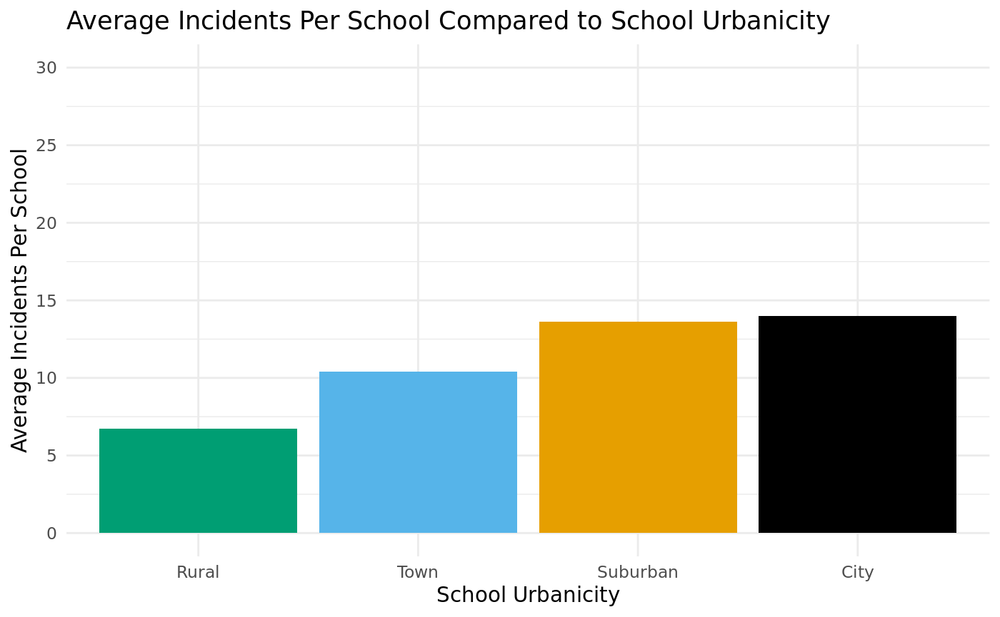
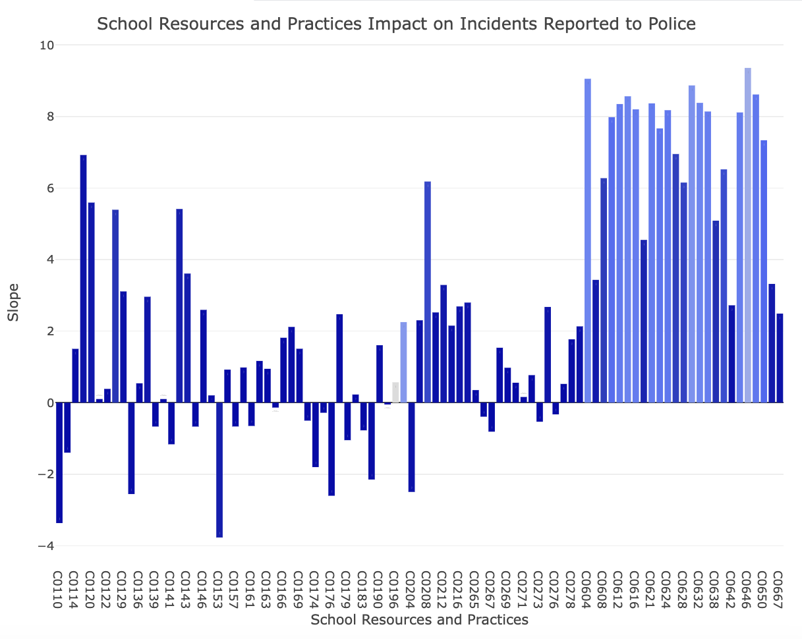
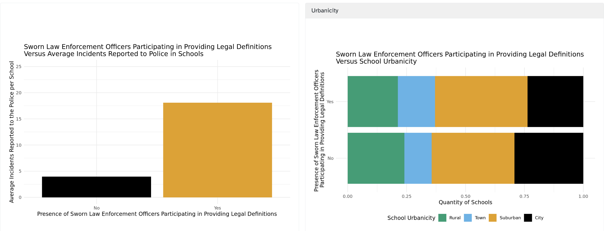
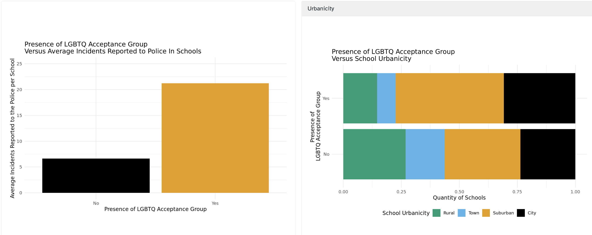
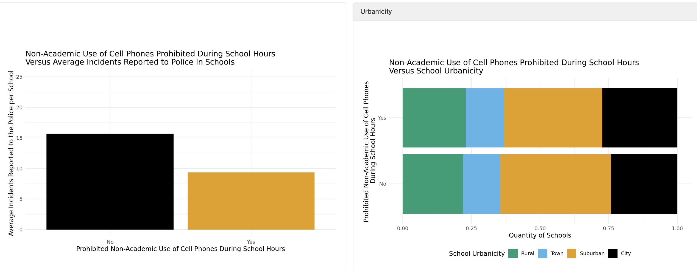
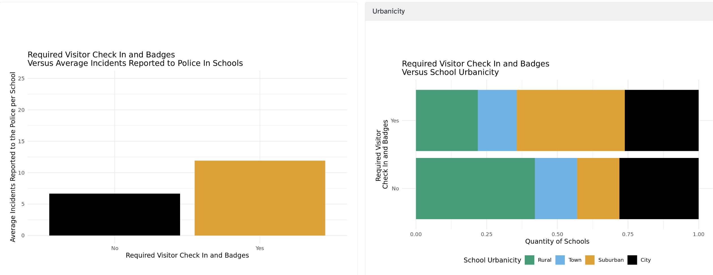

# Write Up

## Justification and Goals

With the rising urgency of social justice and equity, we believed that analyzing the conditions of school resources and practices would reveal patterns in schools that are likely to have a high school-to-prison rate (measured by incidents reported to police). It is publicly accepted that more resources equate to less crime and incidents, but can this be verified with data? Moreover, if this relationship is true, what specific resources can be attributed to lowering the rate of incidents reported to the police in a school? Thus, we seek to delve into the research question, "How are school resources and practices associated with incidents reported to the police?"

```{r}
#| label: load-packages-data
#| message: FALSE

library(shinydashboard)
library(haven)
library(tidyverse)
library(scales)
library(ggthemes)
library(forcats)
library(tidymodels)
library(plotly)

school_safety <- read_sas("data/pu_ssocs18.sas7bdat")
original_school_safety <- read_sas("data/pu_ssocs18.sas7bdat")
theme_set(theme_minimal(base_family = "Atkinson Hyperlegible"))

```

## Dataset

Our project utilizes the school_safety dataset sourced from the School Survey on Crime and Safety (SSOCS), covering the 2017-2018 school year. The SSOCS, overseen by the National Center for Education Statistics, conducts a comprehensive national survey targeting U.S. K-12 public schools. It gathers detailed information regarding the occurrence, frequency, severity, and nature of violence impacting students and school personnel. Additionally, it captures data on the support resources, practices, and policies implemented by schools to prevent and address incidents of crime. The dataset comprises information from `r nrow(original_school_safety)` schools selected from a sample of 84,418 national public schools, using stratification methods and adjustments to account for non-response bias. 

## Introducing Variables

Our data dashboard aims to investigate the impact of school support resources and practices on `INCPOL18` - the incidents of crimes in public schools reported to the police (the specifics of the breakdown of what incidents entails is available [here](https://sta113-f23.github.io/project-2-data-diggers/variables.html)). To analyze this relationship, the project visualizes the correlation by creating a composite variable (resource_sum) derived from the combination of 30 selected variables. These variables include support resources and practices such as mental health support, acceptance groups, community involvement, and more, which are plotted against incidents reported to the police. We explore predictors of incidents reported to the police by employing regression models on support resources and practice variables. To further delve into these predictors and eliminate potential confounding factors arising from school characteristics, we utilize the following variables:

1\. FR_URBAN: This variable measures urbanicity by categorizing a school location as city, suburb, town, or rural.

2\. FR_SIZE: This variable categorizes school size into four groups based on the number of students: "\> 300," "300 - 499," "500 - 999," and "1000 +."

## Analysis Process

```{r}
#| label: filter-data

# filter the data, create final dataset to use
school_safety <- school_safety |>
  select(
    SCHID, # Unique school identifier
    INCPOL18, # Total number of incidents reported to police
    FR_URBAN, # Urbanicity - Based on urban-centric location of school
    FR_SIZE, # Size of school
    C0110:C0186, # School Practices and Programs 
    C0600,
    C0604:C0610,
    C0190:C0192,
    C0204:C0218,
    C0610:C0650,
    C0661,
    C0667,
    C0266:C0277, # Teacher Training
  )

school_safety <- school_safety |>
  mutate_at(vars(starts_with("C")), ~ str_replace(., "2", "0")) |>
  mutate_at(vars(starts_with("C")), ~ str_replace(., "-1", "0")) |>
  mutate(
    across(starts_with("C"), as.numeric),
    resource_sum = 
           C0183 + C0181 + C0179 + C0186 + C0604 + C0606 + C0608 + C0190 + 
           C0192 + C0204 + C0206 + C0208 + C0210 + C0212 + C0214 + C0216 + 
           C0218 + C0266 + C0268 + C0265 + C0267 + C0269 + C0270 + C0272 + 
           C0278 + C0271 + C0273 + C0274 + C0276 + C0277 + C0610,
    FR_URBAN = as.factor(FR_URBAN)
  ) |>
  arrange(resource_sum) 
```

Starting with our original research question, we sought to plot the resources against the incidents reported to the police. To quantify resources for every school, we created a resource score for every school made from 30 variables representing 10 categories of school resources. The breakdown of these variables can be viewed [here](https://sta113-f23.github.io/project-2-data-diggers/variables.html).

### What qualifies as an incident?

Our dataset defines incidents with the combination of 16 other variables, all recording some type of violence or crime. (These specific variables can be read about [here](https://sta113-f23.github.io/project-2-data-diggers/variables.html).)

{width="446"}

### Resource Sum vs. Incidents Reported to Police Graph 

This scatter plot plots the relationship between the resource score and the number of incidents. We used geom_jitter in order to increase the visual variability. Originally, we expected to see a decrease in the number of incidents as the resources increased, but instead, we saw a slightly increasing trend. As the number of resources increased, the number of incidents also increased. 

Because of this trend, we decided to look further into what specific resources could have impacted the number of incidents reported to the police. 

We also decided to analyze which factors could potentially be confounding variables when we analyzed the resources. 

{width="467"}

### School Size Graph 

This graph plots the correlation between school size and the average number of incidents reported to the police per school. In the graph, we can clearly see that there are more incidents per school for schools that have more than 1000 students. This may logically follow because the more students there are in the school, the more incidents are likely to happen and be reported to the police.

{width="462"}

### Urbanicity Graph

We also plotted the school urbanicity in relation to the average number of incidents reported to the police per school. From this plot, we are able to see that city schools have more incidents reported to the police per school followed closely by suburban schools. However, town and rural schools have fewer average incidents per school. This means that urbanicity also has the potential to be a confounding variable as we are analyzing the relationship between the school resource and the number of incidents reported to the police. 

{width="495"}

### Regression Graph 

This plot depicts the impact of the resources and practices of a school on the number of incidents reported to the police. The plot was made with regressions for each of the variables indicating whether a school has a practice or a resource. Moreover, to address the confounding variable of school size, we made each regression a joint regression with the school size. Each bar's colors are based on the r-squared value from the respective regression. The y axis represents the respective slopes that we got from each regression. 

In the graph, there are two values that stand out to be increasing the number of incidents reported to the police: C0646 and C0604. C0646 signifies law enforcement officers participating in creating legal definitions. C0604 signifies the presence of LGBTQ acceptance groups. 

There are two values that stand out to be decreasing the number of incidents reported to the police: C0153 and C0110. C0153 is the prohibition of cell phone use. C0110 signifies if the school requires visitor check in and badges. 

## Subgraphs Tabs

To visualize how the presence of law enforcement providing legal definitions, LGBTQ acceptance groups, prohibition of cell phone use, and requirement of visitor check in and badges affect the number of incidents reported to the police, we created two bar graphs for each variable. The graph on the left shows the average incidents reported to the police per school in the presence or absence of each variable. We chose to plot the average incidents to account for the different numbers of schools that have the variable and those that do not. The graph on the right serves to identify whether urbanicity is a confounding variable, as it demonstrates the urbanicity composition of schools with and without the variable.



### **Legal Definitions**

The graph on the left illustrates a discrepancy in average incidents reported to the police in schools with or without sworn law enforcement officers participating in providing legal definitions. On average, there are about 12 more incidents reported to the police per school in the presence of officers providing legal definitions. The urbanicity graph shows that the distribution of schools of different urbanicity does not vary in the presence or absence of law enforcement officers.  Thus, we speculate that urbanicity does not obscure the significance of this variable. 

Our research into national policies suggests that in response to increased incidents, many schools mistakenly implement harsh security measures with the goal of forcefully preventing crime. The "zero tolerance policies" often include inclusion of security guards and police officers within the school setting. Analysts suggest that the more the institution resembles a prison, the more likely students are to fall into the school-to-prison pipeline (Schept, 2014). As supported by our visualizations, inclusion of officers could potentially be the factor that catalyzes the criminalization of the youth. 



### **LGBTQ Group**

The graph on the left suggests that the average number of accidents reported to the police at schools without an LGBTQ acceptance group is about 7 compared to over 20 in schools with an LGBTQ acceptance group. We found this discrepancy surprising as we found no research suggesting a strong association between inclusivity groups and incidents of crime.  

However, we noticed that the urbanicity distribution of schools with or without LGBTQ groups varies. The majority of schools with LGBTQ acceptance groups are city and suburban schools.  Here, urbanicity is a potential confounding variable. As discussed previously, there are more average incidents per school for city and suburban schools compared to town and rural. Thus, despite the contrast in average number of incidents reported to police per school, the presence of LGBTQ acceptance groups in school might not be a strong contributor to increase in incidents reported to the police. 



### **Prohibit Cell Phone Use**

The graph suggests that, on average, five fewer incidents are reported to the police in schools with policies prohibiting non-academic use of cell phones during school hours. Since the distribution of schools with different levels of urbanicity does not vary in presence or absence of this policy, we speculate that urbanicity should not be considered a confounding variable. 

A possible explanation for the pattern of higher incidents when cell phone use is allowed during school depicted in these graphs may come from research that shows how increased cell-phone use poses a risk for cyberbullying (Shin and Ahn). Therefore, if rules against cell phone usage in a school environment do not exist, students may engage more often online and become involved in cyberbullying. 



### **Visitor Check In and Badges**

The graph on the left suggests that the average number of accidents reported to the police at schools without required visitor check in and badges is around 6 compared to around 12 in schools with the policy. This trend is in line with research on how harsh implementation of security measures often lead to increased incarceration and report of crimes. 

On the right, the urbanicity graph suggests that suburban schools composed the majority of the schools with the policy, while rural schools constitute almost half of the schools without the policy. As mentioned previously, there are more average incidents per school for city and suburban schools compared to town and rural. Thus, urbanicity could be a confounding variable accounting for the discrepancies observed.

## Limitations

Our dataset only represented the portion of the SSOCS published for public use and did not provide access to accurate sizing of the school. If specific information about school size was available, we would have been able to visualize average incidents per student instead of average incidents per school, which would have allowed us to better circumvent the potential confounding variable of school size. 

The calculated r-squared values for each of the school resources and practices were mostly less than 0.5. Low r-squared values indicate that the model is a poor fit. However, this could also be due to each variable's binary structure and the presence of confounding variables. 

It is possible that more confounding variables have skewed the data. Due to time limitations, we were unable to analyze more possible confounding variables other than size and urbanicity. However, this could be an opportunity for further research in the future.

The SSOCS dataset was collected in the 2017-2018 school year, and the conditions of the educational system could have changed since the schools were surveyed, meaning that our current conclusions may be inaccurate or outdated. 

Our original research question stemmed from statistics about the school-to-prison pipeline. However, our data analyzes differences in the incidents that were reported to the police. While incidents reported to the police have a certain similarity to future incarceration, it is difficult with this data to draw a clear and certain pipeline.

Our data does not have a clear variable that defines or measures the school to prison pipeline, so visualizing incidents reported to the police as a way to represent a contributor to this pipeline may be a shortcoming of this project and a source of error in our analysis.

## Conclusion

Our project explores the intricate relationship between school resources, practices and reported incidents to the police. While our initial expectation presumed a decrease in incidents with increased resources, the data visualizations emerged differently. Upon applying regression models, law enforcement officers, LGBTQ acceptance groups, prohibition of cell phones, and strict visitor check-ins stood out as impactful variables. However, the urbanicity of the school appeared as a confounding variable when analyzing the contribution of LGBTQ acceptance groups and visitor check-ins. Our exploration underscores the nuanced interplay between resources, policies, and incident reporting while highlighting the critical need for further research of school resources to formulate more targeted interventions for the school-to-prison pipeline.  

## Works Cited

Kayla M. Gass, & Judson C. Laughter. (2015). "Can I Make Any Difference?" Gang Affiliation, the School-to-Prison Pipeline, and Implications for Teachers. The Journal of Negro Education, 84(3), 333--347. https://doi.org/10.7709/jnegroeducation.84.3.0333

Schept, J., Wall, T., & Brisman, A. (2014). Building, Staffing, and Insulating: An Architecture of Criminological Complicity in the School-to-Prison Pipeline. Social Justice, 41(4 (138)), 96--115. http://www.jstor.org/stable/24871277

Tuzzolo, E., & Hewitt, D. T. (2006). Rebuilding Inequity: The Re-Emergence of the School-to-Prison Pipeline in New Orleans. The High School Journal, 90(2), 59--68. http://www.jstor.org/stable/40364210

Shin N, Ahn H. Factors Affecting Adolescents' Involvement in Cyberbullying: What Divides the 20% from the 80%? Cyberpsychol Behav Soc Netw. 2015 Jul;18(7):393-9. doi: 10.1089/cyber.2014.0362. PMID: 26167838.

\
